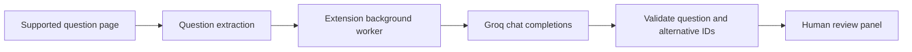

# AI Study Assistant

A Chrome Manifest V3 extension that extracts multiple-choice questions and presents AI-assisted suggestions for human review. A separate, explicitly configured laboratory mode supports an authorized automation demonstration.

**JavaScript · Chrome Extensions · Groq · GPT-OSS**

## Normal study workflow

1. The content script extracts question and alternative IDs from a supported page.
2. The background worker reads locally configured credentials and sends bounded batches to Groq.
3. The client validates the returned JSON against the actual IDs sent; invented alternatives are discarded.
4. The page panel shows a suggested answer, explanation and model-estimated confidence. The user reviews and answers manually.



## Installation and configuration

Open `chrome://extensions`, enable Developer mode, choose **Load unpacked**, and select this repository. Open the extension options, enter your own Groq API key, select a model and save. The implemented default is `openai/gpt-oss-20b`, served through Groq; it does not require an OpenAI account key. Model availability and quotas depend on the provider and account.

Keys are kept in `chrome.storage.local`, restricted to trusted extension contexts. They are not embedded in source or sent to the content script. Local extension storage is not a server-side secrets vault; do not distribute your browser profile.

## Separate authorized laboratory

The laboratory is enabled only for the exact hostname configured in the options. It demonstrates page automation, media/state handling, timing metadata and completion behavior in an authorized environment. `lib/lab-scope.js` and the background worker recheck the hostname. Clearing the hostname disables this mode.

Laboratory behavior is separate from the normal recommendation panel. The included demonstration uses a randomized 15–19 minute interval and waits for the corresponding elapsed time. Platform selectors, exposed Vue state and network contracts are implementation-specific. A hostname setting is a technical restriction, not permission to automate a third-party service. Obtain authorization for the demonstration environment.

## Provider contract

The non-streaming client requests JSON object output with temperature 0 and a maximum completion budget of 2,048 tokens. Batches contain up to eight questions and approximately 12,000 characters. Oversized questions and questions with more than 20 alternatives are rejected. Every returned question/alternative ID is checked before the recommendation reaches the page.

```json
{"answers":[{"questionId":"demo-q1","alternativeId":"demo-a2","explanation":"A short explanation for review.","confidence":0.8}]}
```

Confidence is a model estimate, not a calibrated probability. The model can be wrong.

## Source map and checks

| File | Responsibility |
| --- | --- |
| `manifest.json` | Permissions, host scope and extension entry points |
| `background.js` | Internal messages, configuration and provider dispatch |
| `lib/groq-client.js` | Batching, HTTP contract and response validation |
| `content.js` | Extraction and recommendation panel |
| `lab-mode.js`, `presentation-timing.js`, `lib/lab-scope.js` | Separate authorized demonstration |
| `options.*` | Local key/model configuration |
| `test/`, `browser-fixture/` | Mock-based contract tests and visual fixture |

Requires Node.js 20+ for `npm test`; the extension has no runtime npm dependencies. Tests do not validate a live provider account, model availability or a real training platform. Question text is sent to Groq when suggestions are requested, so use only content you are authorized to share.

## License

No new distribution license is granted for this source edition. Existing rights and third-party terms remain applicable.

## Verification record

See [snapshot checks and remaining limitations](docs/VERIFICATION.md).
